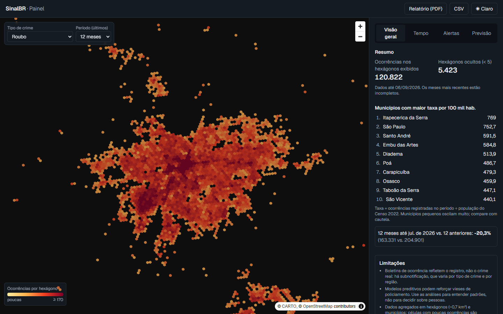
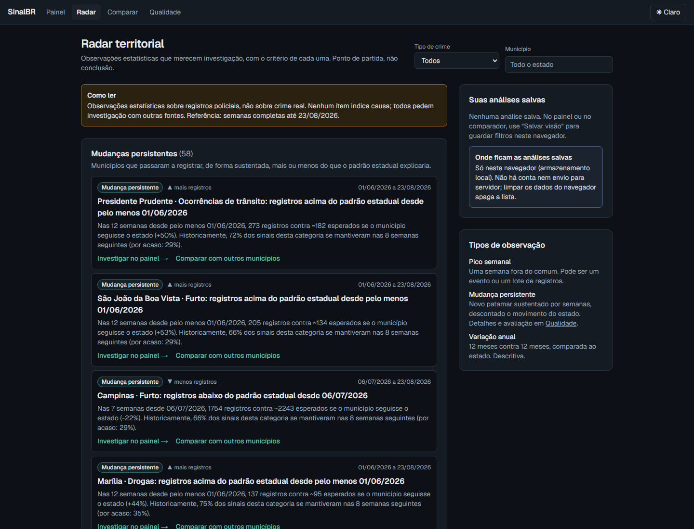
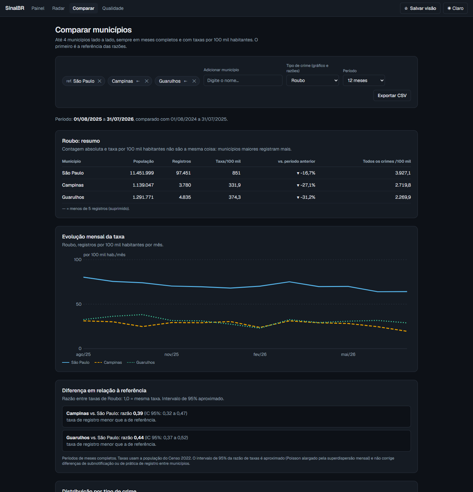
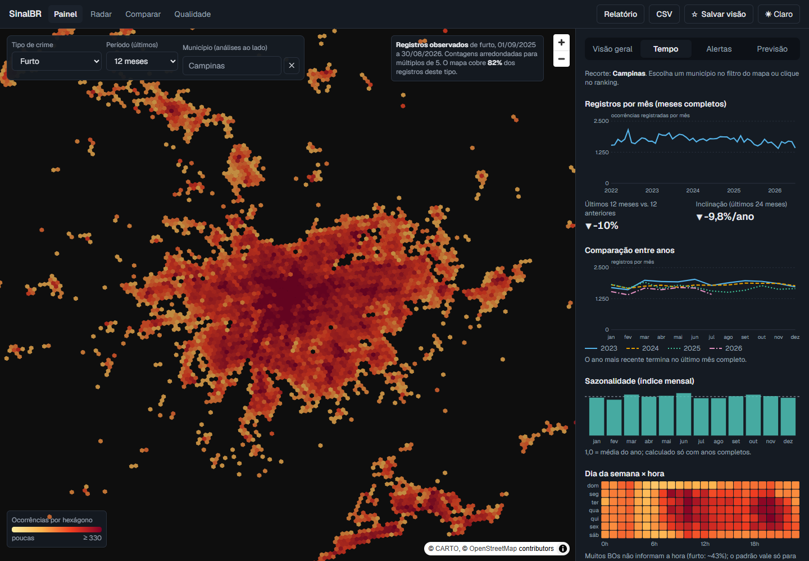
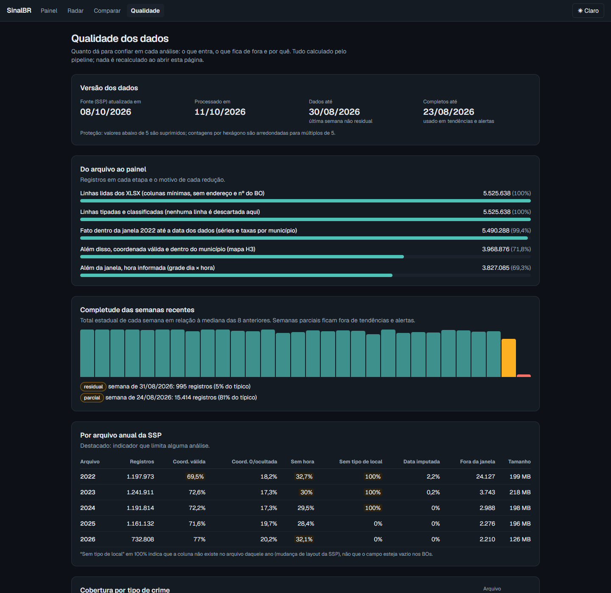
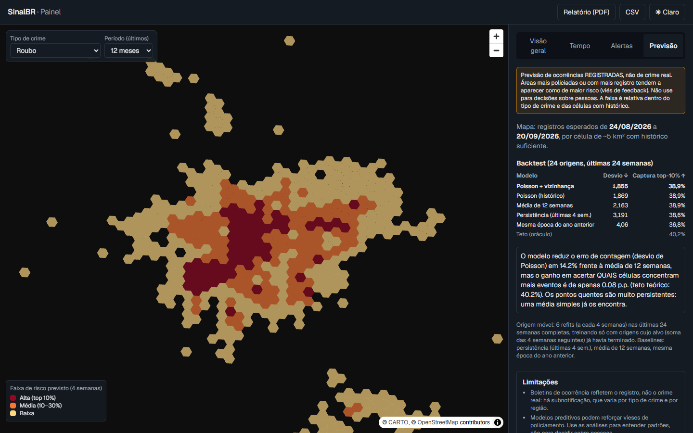
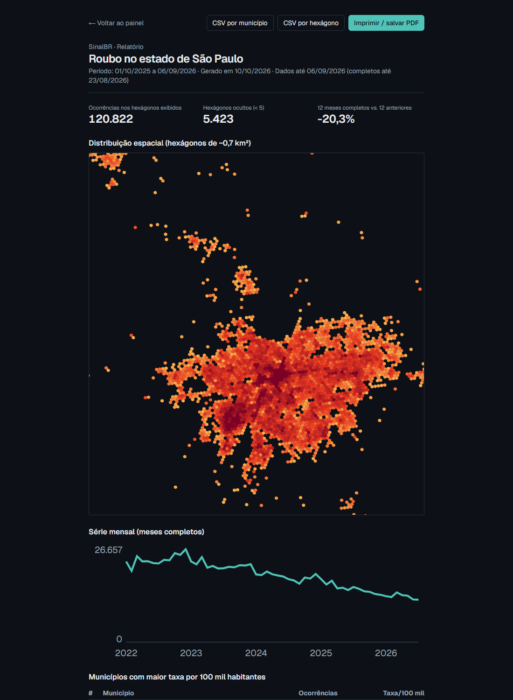
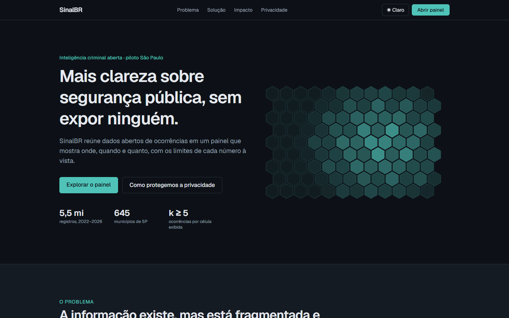
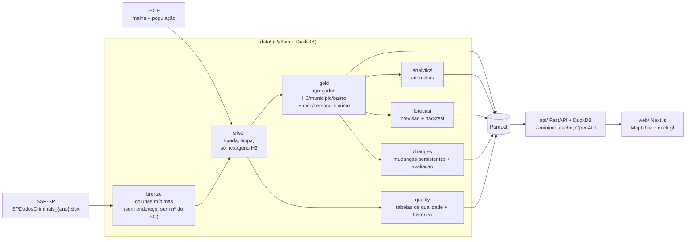

# SinalBR

Plataforma de inteligência criminal construída **somente com dados abertos, agregados e anonimizados** (SSP-SP + IBGE). Piloto em São Paulo, arquitetura pronta para outros estados. Nome provisório: a marca é centralizada em [`web/src/config/brand.ts`](web/src/config/brand.ts).

Projeto de portfólio, independente, sem vínculo com órgãos de segurança. Inspirado no conceito de reunir informação fragmentada para apoiar a análise de segurança pública; marca, textos e design são próprios.



## Limitações: leia antes de usar

- **BOs refletem o registro, não o crime real.** Há subnotificação, que varia por tipo de crime e região.
- **Modelos preditivos podem reforçar vieses de policiamento.** Use para entender padrões, nunca para decidir sobre pessoas.
- Dados agregados (hexágono H3 ~0,7 km², município) com **limite mínimo de 5 ocorrências** por célula. Meses recentes são parciais por atraso de registro.
- ~28% das ocorrências não têm coordenada utilizável (a SSP oculta o local de crimes sexuais); entram nas contagens por município, mas não no mapa.

Detalhes: [privacidade e LGPD](docs/privacidade.md) · [qualidade dos dados](docs/qualidade-dados.md) · [análises](docs/analises.md) · [previsão](docs/previsao.md).

## O que tem

| | |
|---|---|
| **Pipeline** | Ingestão idempotente e incremental dos XLSX da SSP-SP (2022–2026, ~5,5 mi de BOs), limpeza, normalização de naturezas, validação de coordenadas, relatório de qualidade; camadas bronze/silver/gold em Parquet + DuckDB; agregação por H3, município e bairro. |
| **Análises** | Mapa de calor por crime, tendência e sazonalidade, comparação entre anos, dia da semana × hora, taxas por 100 mil hab. (Censo 2022), picos semanais. |
| **Radar territorial** | Porta de entrada da investigação. Reúne mudanças persistentes (CUSUM relativo ao padrão estadual + controle de falsas descobertas de Benjamini–Hochberg), variações anuais fora do padrão do estado, picos semanais e avisos de dados. Cada item mostra o critério e o **histórico**: novo, persistente, histórico insuficiente ou deixou de ser detectado. |
| **Comparador** | Até 4 municípios: contagem e taxa lado a lado, razão de taxas com intervalo de 95% aproximado, distribuição por tipo de crime, evolução mensal e CSV. |
| **Qualidade** | Funil do pipeline, cobertura por ano e por tipo de crime, completude semanal, histórico de execuções e avaliação do detector de mudanças. |
| **Previsão** | Registros esperados nas próximas 4 semanas por célula de ~5 km², com baselines simples e backtest de origem móvel sem vazamento. |
| **Relatório** | Relatório analítico de 12 seções (estado ou município): resumo executivo calculado, indicadores, evolução, categorias, território, radar, qualidade, metodologia, limitações e fontes. PDF pela impressão do navegador. |
| **API** | FastAPI tipada (Pydantic), paginação, filtros, cache, OpenAPI em `/docs`, exportação CSV, 503 explícito quando falta uma etapa do pipeline. |
| **Investigar** | Aba do painel que testa se uma variação se sustenta (janelas, sazonalidade, incerteza, estado) e decompõe a variação do total por tipo de crime e por município. |
| **Web** | Landing e produto em Next.js (MapLibre, deck.gl); filtros sincronizados com a URL, busca de municípios, análises salvas no navegador, tema claro/escuro, responsivo. |

| Radar territorial | Comparador de municípios |
|---|---|
|  |  |

| Série, comparação entre anos e horário | Qualidade dos dados |
|---|---|
|  |  |

| Previsão com backtest | Relatório (PDF) |
|---|---|
|  |  |

> Nas capturas, o mapa-base (CARTO) não carregou no navegador headless usado para gerar as imagens; no navegador comum ele aparece sob os hexágonos.



## Arquitetura



Princípios: a API **só lê agregados** (gold); coordenadas brutas nunca são persistidas; toda exibição aplica k-mínimo.

## Como rodar

### Com Docker (um comando)

```bash
docker compose up --build
```

Na primeira vez o `pipeline` baixa ~1 GB da SSP-SP e leva ~15 min; nas seguintes é incremental. Depois: painel em <http://localhost:3000>, API em <http://localhost:8000/docs>. Variáveis em [`.env.example`](.env.example).

> A CI do GitHub valida o build das três imagens (`docker compose build`). A subida completa (`docker compose up`, que baixa ~1 GB da SSP) ainda não foi executada em um ambiente com Docker; se algo falhar, abra uma issue.

### Sem Docker

Pré-requisitos: Python 3.11+, [uv](https://docs.astral.sh/uv/), Node 20+.

```bash
# 1. Pipeline (baixa ~1 GB; ~15 min na primeira vez)
cd data && uv sync && uv run python -m sinalbr_data all

# 2. API em http://localhost:8000/docs
cd ../api && uv sync && uv run uvicorn app.main:app --port 8000

# 3. Web em http://localhost:3000
cd ../web && npm install && npm run dev
```

Etapas isoladas: `python -m sinalbr_data [bronze|silver|gold|analytics|changes|history|forecast|quality]` (`changes` também atualiza o histórico do radar).

### Testes e qualidade

```bash
cd data && uv run pytest && uv run ruff check . && uv run ruff format --check .
cd api  && uv run pytest && uv run ruff check . && uv run ruff format --check .
cd web  && npm run lint && npm run typecheck && npm test
```

CI no GitHub Actions ([`ci.yml`](.github/workflows/ci.yml)) roda tudo isso e o build das imagens. Pre-commit: `pip install pre-commit && pre-commit install` (ruff, eslint/tsc, bloqueio de dados brutos).

## API em resumo

| Endpoint | Para quê |
|---|---|
| `GET /v1/heatmap/h3` | Hexágonos H3 res. 8 (k ≥ 5, arredondados a múltiplos de 5), só em janelas de 3/6/12/24 meses até a data dos dados |
| `GET /v1/municipios` | Ranking paginado com taxa por 100 mil hab. |
| `GET /v1/series`, `/v1/tendencia`, `/v1/hora-dia` | Séries, tendência, sazonalidade, horário |
| `GET /v1/municipios/lista` | Todos os municípios (busca), sem contagens |
| `GET /v1/comparacao/{periodos,variacao-municipios,regioes,perfil}` | Comparações; `perfil` = comparador com razão de taxas e IC |
| `GET /v1/anomalias` | Picos semanais recentes (filtro por município) |
| `GET /v1/radar` | Observações com critérios explícitos (filtros por crime e município) |
| `GET /v1/mudancas` | Mudanças persistentes (com p-valor e BH) e a avaliação comparativa do detector |
| `GET /v1/decomposicao` | Contribuição de cada tipo de crime (ou município) para a variação do total |
| `GET /v1/robustez` | A variação se sustenta em outras janelas, na comparação sazonal e frente à incerteza? |
| `GET /v1/qualidade` | Tabelas de qualidade, completude e histórico de execuções |
| `GET /v1/previsao/{h3,backtest}` | Risco previsto e métricas de backtest |
| `GET /v1/export/{municipios,celulas}.csv` | Exportação com supressão (e arredondamento por hexágono) aplicados |

Configuração (variáveis de ambiente, ver [`.env.example`](.env.example)): `SINALBR_LAKE`, `SINALBR_K_MIN` (5), `SINALBR_CELL_ROUND` (5), `SINALBR_CORS`, `SINALBR_CACHE_TTL`, `SINALBR_BRAND`, `NEXT_PUBLIC_API_URL`.

## Resultados e achados (dados reais)

- **Roubo no estado:** −20,3% nos registros dos últimos 12 meses completos vs. os 12 anteriores.
- **Previsão:** o modelo reduz o erro de contagem em 14–18% frente a uma média de 12 semanas, mas o ganho em apontar *quais* células concentram mais ocorrências é de 0,1–0,5 p.p., quase no teto do oráculo (os pontos quentes são muito persistentes). Reportado como está.
- **Mudanças persistentes:** comparamos o detector com uma referência simples e com um modelo que inclui a sazonalidade própria de cada município, no mesmo conjunto de 24.571 avaliações. O modelo sazonal **não** melhorou (pior sob a verdade neutra em todas as faixas e anos) e não foi adotado. O controle de falsas descobertas (BH) trouxe ganho pequeno e consistente (2,33× → 2,37× sobre o acaso). Só 41% dos sinais reaparecem 4 semanas depois, o que motivou o histórico do radar ([docs/mudancas.md](docs/mudancas.md)).
- **Anomalias:** os maiores picos investigados coincidem com eventos de massa (estádio do Morumbi, festas), não com "ondas de crime".
- **Privacidade:** duas rodadas de auditoria com ataques medidos no lake real. A primeira achou diferenciação entre janelas (273 hexágonos); a segunda, supressão complementar no comparador (70 municípios com contagem exata revelada) e no ranking (13). Todos foram corrigidos e são verificados por testes ([docs/privacidade.md](docs/privacidade.md)).
- **Acessibilidade e desempenho (Lighthouse 12, Edge, desktop):** acessibilidade, boas práticas e SEO em 100 nas 5 páginas medidas. Desempenho de 99–100, exceto o painel (75), onde o custo é o JavaScript do mapa (MapLibre/deck.gl).
- **Qualidade:** o layout da SSP muda entre anos (`DESCR_TIPOLOCAL` ausente em 2022–2024); a cobertura do mapa vai de 0% (crimes sexuais, ocultados pela fonte) a 92% (trânsito); furto não tem hora em ~43% dos BOs.

## Decisões técnicas

- **DuckDB + Parquet em vez de PostGIS:** ~5,5 mi de linhas e consultas de agregação cabem em arquivos; H3 vem da extensão `h3` do DuckDB. Migrar para PostGIS só se surgirem escritas concorrentes ou consultas geométricas complexas.
- **Anonimização por design:** logradouro, número e nº do BO são descartados já na leitura; coordenadas viram só um hexágono e depois são descartadas.
- **Ingestão incremental e tolerante a drift:** reprocessa um ano só se tamanho/`Last-Modified` mudou; aliases de colunas por ano; falha alto se faltar coluna obrigatória.
- **Janela de completude:** tendências, comparações e anomalias usam só períodos completos, para não confundir atraso de registro com queda.
- **Baseline primeiro:** o modelo só é apresentado ao lado de baselines e do teto do oráculo.
- **Ambiente Windows restrito:** `pandas`, `pyarrow` e `h3` (DLLs) foram bloqueados por política de aplicativos na máquina de desenvolvimento; o pipeline usa só DuckDB, calamine e numpy, o que também reduziu dependências.

## Estrutura

```
data/   pipeline Python (uv): bronze, silver, gold, analytics, changes, forecast, quality, ibge
api/    FastAPI + DuckDB sobre o Parquet gold (main, analysis, radar, qualidade, previsao)
web/    Next.js + Tailwind + MapLibre/deck.gl (landing, painel, radar, comparar, qualidade, relatório)
docs/   plano, auditoria v2, privacidade, qualidade, análises, mudanças, previsão, imagens
```

Convenções do projeto em [`CLAUDE.md`](CLAUDE.md).

## Limites conhecidos e próximos passos

- Só São Paulo; para outro estado, adicionar a fonte, os aliases de colunas e o relatório de qualidade.
- População fixa do Censo 2022 (sem projeções anuais).
- Sem garantia formal de privacidade: diferenças entre janelas no nível municipal ainda podem revelar somas pequenas (a SSP publica esses números mensalmente); o desenho de privacidade diferencial está documentado, mas não implementado.
- O detector não modela a sazonalidade própria dos municípios (a alternativa foi testada e rejeitada) e o BH não garante a taxa real de falsas descobertas, porque o modelo nulo é aproximado. O histórico do radar é reconstruído com os dados atuais até que haja atualizações reais acumuladas.
- Laboratório de hipóteses, alertas por e-mail e assistente com IA foram avaliados e adiados (motivos em [docs/auditoria-v2.md](docs/auditoria-v2.md)).
- Sem intervalos de previsão; janela de backtest de 6 meses.
- O relatório em PDF usa a impressão do navegador, não geração no servidor.
- Sem licença definida; escolha uma antes de publicar.
