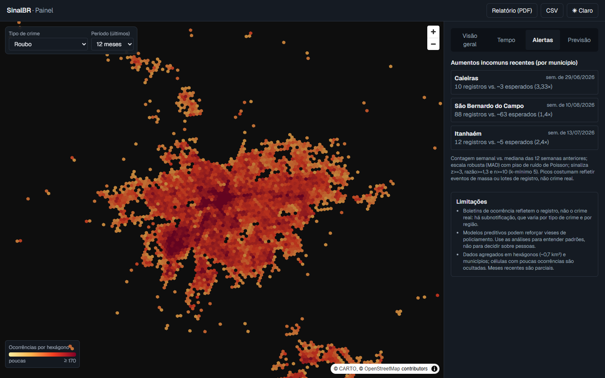
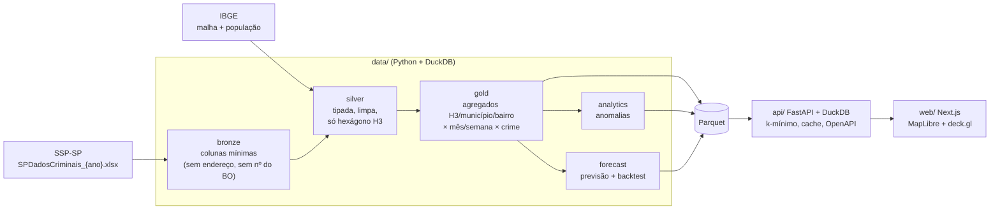

# SinalBR

Plataforma de inteligência criminal construída **somente com dados abertos, agregados e anonimizados** (SSP-SP + IBGE). Piloto em São Paulo, arquitetura pronta para outros estados. Nome provisório: a marca é centralizada em [`web/src/config/brand.ts`](web/src/config/brand.ts).

Projeto de portfólio, independente, sem vínculo com órgãos de segurança. Inspirado no conceito de reunir informação fragmentada para apoiar a análise de segurança pública; marca, textos e design são próprios.


## Limitações: leia antes de usar

- **BOs refletem o registro, não o crime real.** Há subnotificação, que varia por tipo de crime e região.
- **Modelos preditivos podem reforçar vieses de policiamento.** Use para entender padrões, nunca para decidir sobre pessoas.
- Dados agregados (hexágono H3 ~0,7 km², município) com **limite mínimo de 5 ocorrências** por célula. Meses recentes são parciais por atraso de registro.
- ~28% das ocorrências não têm coordenada utilizável (a SSP oculta o local de crimes sexuais); entram nas contagens por município, mas não no mapa.

Detalhes: [privacidade e LGPD](docs/privacidade.md) · [qualidade dos dados](docs/qualidade-dados.md) · [análises](docs/analises.md) · [previsão](docs/previsao.md).

## O que tem

| | |
|---|---|
| **Pipeline** | Ingestão idempotente e incremental dos XLSX da SSP-SP (2022–2026, ~5,5 mi de BOs), limpeza, normalização de naturezas, validação de coordenadas, relatório de qualidade; camadas bronze/silver/gold em Parquet + DuckDB; agregação por H3, município e bairro. |
| **Análises** | Mapa de calor por crime, tendência e sazonalidade, dia da semana × hora, comparação entre períodos e regiões (taxa por 100 mil hab., Censo 2022), detecção de anomalias semanais. |
| **Previsão** | Registros esperados nas próximas 4 semanas por célula de ~5 km², com baselines simples e backtest de origem móvel sem vazamento. |
| **API** | FastAPI tipada (Pydantic), paginação, filtros, cache, OpenAPI em `/docs`, exportação CSV. |
| **Web** | Landing institucional e painel (Next.js, MapLibre, deck.gl), tema claro/escuro, responsivo, relatório imprimível (PDF). |

| Previsão com backtest | Série, sazonalidade e horário |
|---|---|
|  |  |

| Alertas de anomalia | Relatório (PDF) |
|---|---|
|  |  |

> Nas capturas, o mapa-base (CARTO) não carregou no navegador headless usado para gerar as imagens; no navegador comum ele aparece sob os hexágonos.


## Arquitetura



Princípios: a API **só lê agregados** (gold); coordenadas brutas nunca são persistidas; toda exibição aplica k-mínimo.

## Como rodar

### Com Docker (um comando)

```bash
docker compose up --build
```

Na primeira vez o `pipeline` baixa ~1 GB da SSP-SP e leva ~15 min; nas seguintes é incremental. Depois: painel em <http://localhost:3000>, API em <http://localhost:8000/docs>. Variáveis em [`.env.example`](.env.example).

> O Compose foi escrito, mas **não foi executado** no ambiente de desenvolvimento (Docker indisponível lá). A CI faz `docker compose build`; se algo falhar na sua máquina, abra uma issue.

### Sem Docker

Pré-requisitos: Python 3.11+, [uv](https://docs.astral.sh/uv/), Node 20+.

```bash
# 1. Pipeline (baixa ~1 GB; ~15 min na primeira vez)
cd data && uv sync && uv run python -m sinalbr_data all

# 2. API em http://localhost:8000/docs
cd ../api && uv sync && uv run uvicorn app.main:app --port 8000

# 3. Web em http://localhost:3000
cd ../web && npm install && npm run dev
```

Etapas isoladas: `python -m sinalbr_data [bronze|silver|gold|analytics|forecast|quality]`.

### Testes e qualidade

```bash
cd data && uv run pytest && uv run ruff check . && uv run ruff format --check .
cd api  && uv run pytest && uv run ruff check . && uv run ruff format --check .
cd web  && npm run lint && npm run typecheck && npm test
```

CI no GitHub Actions ([`ci.yml`](.github/workflows/ci.yml)) roda tudo isso e o build das imagens. Pre-commit: `pip install pre-commit && pre-commit install` (ruff, eslint/tsc, bloqueio de dados brutos).

## API em resumo

| Endpoint | Para quê |
|---|---|
| `GET /v1/heatmap/h3` | Hexágonos H3 res. 8 com contagem (k ≥ 5) por crime e período |
| `GET /v1/municipios` | Ranking paginado com taxa por 100 mil hab. |
| `GET /v1/series`, `/v1/tendencia`, `/v1/hora-dia` | Séries, tendência, sazonalidade, horário |
| `GET /v1/comparacao/{periodos,variacao-municipios,regioes}` | Comparações |
| `GET /v1/anomalias` | Aumentos incomuns recentes |
| `GET /v1/previsao/{h3,backtest}` | Risco previsto e métricas de backtest |
| `GET /v1/export/{municipios,celulas}.csv` | Exportação com supressão aplicada |

## Resultados e achados (dados reais)

- **Roubo no estado:** −20,3% nos registros dos últimos 12 meses completos vs. os 12 anteriores.
- **Previsão:** o modelo reduz o erro de contagem em 14–18% frente a uma média de 12 semanas, mas o ganho em apontar *quais* células concentram mais ocorrências é de 0,1–0,5 p.p., quase no teto do oráculo (os pontos quentes são muito persistentes). Reportado como está.
- **Anomalias:** os maiores picos investigados coincidem com eventos de massa (estádio do Morumbi, festas), não com "ondas de crime".
- **Qualidade:** o layout dos arquivos da SSP muda entre anos; ~30% dos BOs não têm hora.

## Decisões técnicas

- **DuckDB + Parquet em vez de PostGIS:** ~5,5 mi de linhas e consultas de agregação cabem em arquivos; H3 vem da extensão `h3` do DuckDB. Migrar para PostGIS só se surgirem escritas concorrentes ou consultas geométricas complexas.
- **Anonimização por design:** logradouro, número e nº do BO são descartados já na leitura; coordenadas viram só um hexágono e depois são descartadas.
- **Ingestão incremental e tolerante a drift:** reprocessa um ano só se tamanho/`Last-Modified` mudou; aliases de colunas por ano; falha alto se faltar coluna obrigatória.
- **Janela de completude:** tendências, comparações e anomalias usam só períodos completos, para não confundir atraso de registro com queda.
- **Baseline primeiro:** o modelo só é apresentado ao lado de baselines e do teto do oráculo.
- **Ambiente Windows restrito:** `pandas`, `pyarrow` e `h3` (DLLs) foram bloqueados por política de aplicativos na máquina de desenvolvimento; o pipeline usa só DuckDB, calamine e numpy, o que também reduziu dependências.

## Estrutura

```
data/   pipeline Python (uv): bronze, silver, gold, analytics, forecast, quality, ibge
api/    FastAPI + DuckDB sobre o Parquet gold
web/    Next.js + Tailwind + MapLibre/deck.gl (landing, painel, relatório)
docs/   plano, privacidade, qualidade, análises, previsão, imagens
```

Convenções do projeto em [`CLAUDE.md`](CLAUDE.md).

## Limites conhecidos e próximos passos

- Só São Paulo; para outro estado, adicionar a fonte, os aliases de colunas e o relatório de qualidade.
- População fixa do Censo 2022 (sem projeções anuais).
- A supressão k-mínimo não impede diferenciação entre consultas sobrepostas; para uso público em produção, avaliar ruído diferencial.
- Sem intervalos de previsão; janela de backtest de 6 meses.
- O relatório em PDF usa a impressão do navegador, não geração no servidor.
- Sem licença definida; escolha uma antes de publicar.
